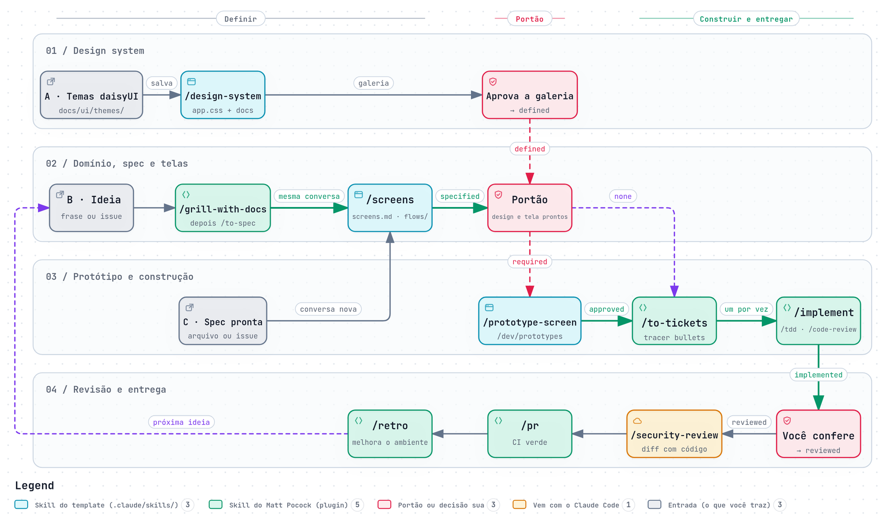

# Phoenix Development Environment

Configure o seu ambiente sem instalar Elixir e Phoenix localmente.
Assim, você não precisa baixar, instalar e configurar dependências, nem criar e construir uma imagem Docker à mão para começar um projeto novo.

## Tecnologias

O template usa:

- Docker
- Docker Compose
- Shell script

O projeto gerado usa:

- Elixir e Phoenix, com LiveView
- PostgreSQL (opcional, com Ecto)
- Tailwind CSS e daisyUI
- GitHub Actions

## Primeiros passos

Para criar o projeto:

- Instale o [`docker`](https://docs.docker.com/engine/install/) e o [`docker compose`](https://docs.docker.com/compose/install/)
- Opcionalmente, instale o `make`, para rodar os comandos do makefile do projeto pelo host (`sudo apt install make` no Ubuntu)

> No Ubuntu, o `run.sh` instala o Docker automaticamente se ele não estiver instalado (veja o [`docker.sh`](https://github.com/VitorGuimaraes/phx_dev_env/blob/master/docker.sh)).  
> Em outros sistemas, instale o Docker manualmente antes de rodá-lo.

Opcionalmente, o CLI [`gh`](https://cli.github.com/), para criar o repositório no GitHub (passo 5). As ferramentas para construir a aplicação estão no README do projeto.

## Como usar

### 1. Clone o repositório

No terminal, use o `git` para clonar o repositório.
> git clone <https://github.com/VitorGuimaraes/phx_dev_env.git>

### 2. Configure as variáveis do projeto no `.env`

No `.env` ficam as variáveis do Postgres e algumas variáveis usadas no [`docker-compose.yaml`](https://github.com/VitorGuimaraes/phx_dev_env/blob/master/docker-compose.yaml).
Os valores padrão funcionam como estão: o `run.sh` define sozinho os nomes, as portas e os ids de usuário.

### 3. Rode o script

> ./run.sh

Ele pergunta o nome do projeto e se você quer usar Ecto, UUID (`--binary-id`) e autenticação (`mix phx.gen.auth`).
As respostas também podem ser passadas como opções (`./run.sh --help`), por exemplo:

> ./run.sh --name my_app --ecto --uuid --auth

Depois, ele:

- cria o projeto Phoenix pelo container, com os arquivos no seu usuário;
- configura o `config/dev.exs` e o `config/test.exs` para usar o banco do `.env` (sem Ecto, o serviço e as variáveis do banco são removidos);
- opcionalmente, gera a autenticação com páginas em LiveView (`mix phx.gen.auth Accounts User users --live`);
- renomeia a pasta atual com o nome do projeto;
- move o `dev.sh` para `scripts/`;
- cria o `.env.example` e adiciona o `.env` ao `.gitignore`;
- adiciona as convenções do projeto ao `AGENTS.md` (Docker, commits, testes, UI e idioma) e cria o `CLAUDE.md`, que o importa;
- adiciona um hook `commit-msg` que valida mensagens no formato `<gitmoji> <type>(<scope>): <description>`;
- define `pt_BR` como locale padrão, com os erros de validação do Ecto traduzidos;
- troca os Heroicons pelos ícones do [`Lucide`](https://lucide.dev/icons), inclusive nos geradores `mix phx.gen.*` (veja `templates/icons/`);
- adiciona [`credo`](https://github.com/rrrene/credo), [`sobelow`](https://github.com/nccgroup/sobelow), [`mix_audit`](https://github.com/mirego/mix_audit) e [`mix_test_watch`](https://github.com/lpil/mix-test.watch) como dependências de dev/test, com o Credo, o Sobelow, o `mix deps.audit` e o `mix hex.audit` no `mix precommit`;
- define uma Content-Security-Policy com um nonce por requisição (`templates/csp/`), para que scripts inline só rodem com o nonce;
- adiciona uma CI no GitHub Actions (`.github/workflows/ci.yml`) com as verificações do `mix precommit`, a busca de segredos commitados ([gitleaks](https://github.com/gitleaks/gitleaks)) e de vulnerabilidades na imagem de produção ([Trivy](https://trivy.dev)), e o Dependabot (`.github/dependabot.yml`); os detalhes estão em "Verificações" no README do projeto;
- gera uma imagem de release para produção (`Dockerfile`, `mix phx.gen.release --docker`); a imagem de desenvolvimento é o `Dockerfile.dev`;
- dá aos containers, à imagem e à rede o nome do projeto e escolhe portas livres no host, para que vários projetos rodem ao mesmo tempo (as portas ficam registradas em `~/.config/phx_dev_env/projects`, então um projeto parado mantém as suas portas);
- instala as fontes Figtree (interface e textos) e Lato (títulos), servidas pelo próprio projeto (veja `templates/fonts/`);
- adiciona o `docs/ui/design-system.md` (definido na primeira tarefa de UI do projeto), o `docs/ui/screens.md` (inventário de telas) e o `docs/ui/themes/`, para os temas exportados do daisyUI;
- prepara os protótipos de telas em `/dev/prototypes` (LiveViews com dados falsos em `dev/`, compiladas só em dev e test, fora da release; veja `templates/prototypes/`);
- adiciona as skills `/design-system`, `/screens`, `/prototype-screen` e `/next-step` para o Claude Code (`.claude/skills/`), que aplicam os temas do daisyUI, transformam as user stories de uma spec em telas e as telas em protótipos, e dizem qual é o próximo passo;
- substitui o `README.md` do projeto por um em português, com as instruções de desenvolvimento e os passos de construção da aplicação;
- inicia um novo repositório git.

Se o Docker for instalado pelo script, saia da sessão e entre de novo (para aplicar o grupo `docker`) e rode o `./run.sh` outra vez.  
Veja o [`run.sh`](https://github.com/VitorGuimaraes/phx_dev_env/blob/master/run.sh) para mais detalhes.  

### 4. Comece a desenvolver

Vá para a pasta do projeto e siga o `README.md` dele: "Desenvolvimento" mostra como subir os serviços e o servidor, e as seções seguintes trazem os comandos do makefile e do Docker e a conexão com o banco.
> cd ../<project_name>

Acesse `http://localhost:<APP_HOST_PORT>` (mostrado no fim do `run.sh` e definido no `.env`, padrão `4000`) e confira a página do Phoenix.

### 5. Publique no GitHub

O `run.sh` inicia o repositório git sem commits. Faça o primeiro commit e o push, para que a CI rode a cada push:

> git add .  
> git commit -m "🔧 chore: create the project"

Com o CLI `gh` (logado com `gh auth login`):
> gh repo create <project_name> --private --source . --push

Ou crie um repositório vazio no GitHub (sem README, licença ou `.gitignore`) e faça o push para ele:
> git remote add origin git@github.com:<user>/<project_name>.git  
> git push -u origin HEAD

A primeira execução da CI leva alguns minutos (as seguintes usam o cache); acompanhe na aba Actions do repositório.

Para receber na hora os PRs de correção de segurança do Dependabot (sem esperar a atualização semanal), ative "Dependabot alerts" e "Dependabot security updates" em Settings → Advanced Security do repositório.

### 6. Construa a aplicação

A aplicação é construída com o [Claude Code](https://claude.com/claude-code), aberto na pasta do projeto, e as [skills do Matt Pocock](https://github.com/mattpocock/skills): do design system e da spec aos protótipos, tickets, implementação guiada por testes e PR. O passo a passo, as ferramentas e por onde começar estão em "Construção da aplicação" no `README.md` do projeto (gerado a partir do [`templates/README.development.md`](templates/README.development.md)).

A versão interativa, com tema claro e escuro, zoom e os cards das pastas, dos templates e das verificações, está em [`docs/fluxo-de-desenvolvimento.html`](docs/fluxo-de-desenvolvimento.html) (abra o arquivo no navegador; o GitHub mostra só o código-fonte).

O diagrama foi gerado com a skill [Archify](https://github.com/tt-a1i/archify); a fonte é o [`templates/docs/fluxo-de-desenvolvimento.archify.json`](templates/docs/fluxo-de-desenvolvimento.archify.json). Para atualizá-lo, edite o JSON e peça ao Claude Code para rodar o `finalize` do Archify de novo.

### 7. Teste o template

O `e2e.sh` testa o `run.sh` de ponta a ponta: cria um projeto a partir de uma cópia temporária desta pasta (incluindo as mudanças não commitadas), confere os arquivos gerados, roda o `mix setup`, o `mix precommit` e o servidor nos containers reais, e remove tudo no fim.

> ./e2e.sh                 # com Ecto  
> ./e2e.sh --auth --release   # com autenticação, gerando também a imagem de produção  
> ./e2e.sh --no-ecto  
> ./e2e.sh --keep          # mantém o projeto para inspecioná-lo
