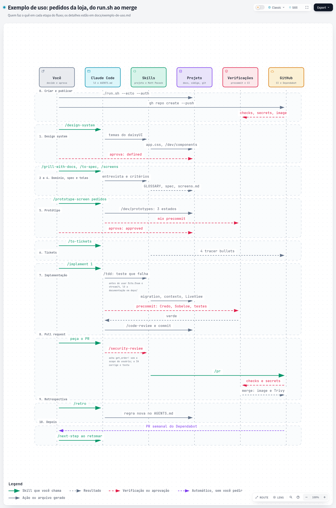

# Exemplo de uso: do `run.sh` ao merge

Este documento acompanha uma funcionalidade inteira pelo fluxo de desenvolvimento, para mostrar
como as skills, as bibliotecas e as verificações do projeto se encaixam. É um exemplo
narrativo: os trechos são ilustrativos, e o que a IA escreve de fato varia de projeto para
projeto. O passo a passo de referência está em "Construção da aplicação" no `README.md`, e o
que cada ferramenta faz está em "Stack e ferramentas".

[](exemplo-de-uso.html)

A versão interativa do diagrama está em [`exemplo-de-uso.html`](exemplo-de-uso.html) (abra o
arquivo no navegador).

## O cenário

Uma loja pequena quer que os **clientes acompanhem os próprios pedidos**: ver a lista, abrir um
pedido e saber em que etapa ele está. O projeto se chama `loja` e usa Ecto, UUID e autenticação.

| Etapa | Skills | O que entra em ação |
|---|---|---|
| 0. Criar e publicar | — | `run.sh`, `gh`, a primeira CI, o Dependabot |
| 1. Design system | `/design-system` | daisyUI, Tailwind, Figtree e Lato, `/dev/components` |
| 2 a 4. Domínio, spec e telas | `/grill-with-docs`, `/research`, `/to-spec`, `/screens` | `GLOSSARY.md`, ADR, spec, `docs/ui/screens.md`, `docs/ui/flows/` |
| 5. Protótipo | `/prototype-screen` | `/dev/prototypes`, Lucide, Gettext, `mix precommit` |
| 6. Tickets | `/to-tickets` | tracer bullets |
| 7. Implementação | `/implement`, `/tdd`, `/code-review` | Ecto, scopes, streams, LiveViewTest, a regra do `deps/`, o `precommit` inteiro, o hook `commit-msg` |
| 8. PR | `/security-review`, `/pr` | a CI (`checks`, `secrets`, `image` com o Trivy) |
| 9. Retrospectiva | `/retro` | `AGENTS.md` |
| 10. Depois | `/next-step`, `/diagnosing-bugs` | Dependabot |

## 0. Criar e publicar

**Você:**

```bash
git clone https://github.com/VitorGuimaraes/phx_dev_env.git
cd phx_dev_env
./run.sh --name loja --ecto --uuid --auth
cd ../loja
git add . && git commit -m "🔧 chore: create the project"
gh repo create loja --private --source . --push
```

**O `run.sh`** cria o projeto Phoenix pelo container, gera a autenticação em LiveView
(`mix phx.gen.auth`), escolhe portas livres (por exemplo, a app em `localhost:4000` e o banco
em `localhost:6032`, as duas só nesta máquina), troca os Heroicons pelo Lucide, instala as
fontes, define a Content-Security-Policy com nonce, adiciona o Credo, o Sobelow e as auditorias
ao `mix precommit` e escreve o `AGENTS.md`, o `CLAUDE.md` e as skills do projeto.

**No push**, a CI roda três jobs: `checks` (as mesmas verificações do `precommit`, com o
PostgreSQL como serviço), `secrets` (o gitleaks no histórico) e `image` (o build da release e o
Trivy, que procura vulnerabilidades na imagem). A partir da semana seguinte, o Dependabot abre
os PRs de atualização.

Então suba os serviços e o servidor: `make up`, `make app.setup` e `make app`.

## 1. Design system

Feito uma vez, numa conversa separada, enquanto as etapas 2 a 4 andam.

**Você** monta os temas `light` e `dark` no gerador do daisyUI, salva o CSS em
`docs/ui/themes/light.css` e `docs/ui/themes/dark.css`, abre o Claude Code na pasta do projeto e
roda:

```
/design-system
```

**A IA** copia as variáveis dos temas para o `assets/css/app.css`, mede o contraste dos textos
(e pergunta antes de mudar uma cor que não passa), preenche o `docs/ui/design-system.md` com os
papéis das cores, da tipografia (Figtree nos textos, Lato nos títulos) e dos componentes, cria
a galeria em `/dev/components` e faz o commit.

**Você** confere a galeria nos dois temas e aprova. A IA marca o design system como `defined`.
A partir daí, toda tela usa só esses componentes, cores e fontes.

## 2 a 4. Domínio, spec e telas

As três etapas rodam numa única conversa, sem `/clear`.

**Domínio.** Você roda:

```
/grill-with-docs os clientes acompanham os próprios pedidos
```

A IA entrevista em rodadas, sempre com uma resposta recomendada:

> **Pergunta 3.** Quais são as etapas de um pedido? Recomendo: `recebido`, `em separação`,
> `enviado` e `entregue`, sem voltar de etapa. Um pedido cancelado é uma etapa ou outra coisa?

As respostas viram termos no `GLOSSARY.md` (Pedido, Item do pedido, Etapa) e decisões em
`docs/adr/`, como "0001: a etapa do pedido é um `Ecto.Enum`, e só avança". Quando uma resposta
depende de documentação (por exemplo, "o `Ecto.Enum` guarda o valor como string ou como
inteiro?"), você pede um `/research`, e um agente lê a documentação em segundo plano e devolve
um arquivo com as citações.

**Spec.** `/to-spec` escreve o problema, a solução e as user stories numeradas, sem entrevistar
de novo:

> 1. Como cliente, quero ver a lista dos meus pedidos, para saber o que já comprei.
> 2. Como cliente, quero abrir um pedido, para ver os itens e a etapa em que ele está.
> 3. Como cliente, não quero ver os pedidos de outra pessoa.

**Telas.** `/screens <spec>` completa os critérios de aceite de cada story, perguntando o que
a spec não diz:

> - Dado que não tenho pedidos, quando abro `/orders`, então vejo "Você ainda não tem pedidos".
> - Dado um pedido de outro cliente, quando abro o endereço dele, então vejo "Pedido não
>   encontrado".

Em seguida, propõe duas telas e o protótipo de cada uma. Depois da sua confirmação, grava as
entradas em `docs/ui/screens.md` e o fluxo em `docs/ui/flows/pedidos.md`:

```markdown
## Pedidos

- Route: `/orders` — LiveView: `LojaWeb.OrderLive.Index`
- Specs: `docs/specs/pedidos.md` (stories 1, 3)
- States: com pedidos, vazio, outro cliente
- Prototype: required
- Status: specified
```

A tela `/orders/:id` fica com `Prototype: none`, porque os componentes existentes bastam. Com
isso a spec está definida, e você roda `/clear`.

## 5. Protótipo

Numa conversa nova:

```
/prototype-screen pedidos
```

**A IA** cria `LojaWeb.Prototypes.OrderLive.Index` em `dev/loja_web/prototypes/`, com os estados
`filled`, `empty` e `not_found` e dados falsos em português (nomes longos, listas compridas,
etapas variadas). Ela usa só o design system: os componentes do daisyUI, os ícones do Lucide
(`lucide-package` para o pedido, `lucide-truck` para `enviado`) e `gettext` em todo texto. Roda
o `mix precommit`, cujo teste dos protótipos renderiza todos os estados, marca a tela como
`prototyped` e faz o commit.

**Você** abre `localhost:4000/dev/prototypes/orders`, troca os estados e o tema na barra de
ferramentas e vê a tela no celular e no desktop. Você pede "mostre a data prevista de entrega
nos pedidos enviados". Isso é um dado novo, então a IA atualiza antes os critérios da spec e a
entrada em `docs/ui/screens.md`: o protótipo nunca decide uma regra sozinho.

Quando estiver certo, **você** muda o status para `approved`. A IA move o markup para
`order_list/1` em `lib/loja_web/components/order_components.ex`, que o LiveView real vai usar,
e sugere os tickets: o estado `filled` é o esqueleto, e cada outro estado vira um ticket
bloqueado por ele.

## 6. Tickets

Numa conversa nova, `/to-tickets docs/specs/pedidos.md`. A IA propõe os tracer bullets, você
ajusta e ela os publica:

| Ticket | Critérios | Bloqueado por |
|---|---|---|
| 1. Esqueleto: lista de pedidos | caminho principal (`filled`) | — |
| 2. Estado vazio | `empty` | 1 |
| 3. Detalhe do pedido | stories 2 e a data prevista | 1 |
| 4. Pedido de outro cliente | `not_found` | 3 |

Cada ticket atravessa todas as camadas de que precisa e já aparece no navegador. Nenhum ticket
é "criar os schemas".

## 7. Implementação

Uma conversa por ticket, começando pelo que não tem bloqueio:

```
/implement 1
```

**A IA** trabalha com `/tdd`: primeiro um teste de LiveView que falha (`Phoenix.LiveViewTest`
com o LazyHTML), depois o mínimo de código para ele passar.

```elixir
test "lista os pedidos do cliente", %{conn: conn, user: user} do
  order_fixture(user, number: "1042")
  {:ok, view, _html} = live(conn, ~p"/orders")
  assert has_element?(view, "#orders", "1042")
end
```

Para fazê-lo passar, ela escreve a migration, o schema `Loja.Orders.Order` com
`field :stage, Ecto.Enum`, a função `Orders.list_orders(scope)`, que recebe o scope do usuário
gerado pelo `phx.gen.auth`, e o LiveView com um stream, renderizando o `order_list/1` aprovado.
Antes de usar o `Ecto.Enum` e o `stream/4`, ela lê a documentação em `deps/`, na versão do
`mix.lock`, como manda o `AGENTS.md`.

Antes do commit, roda o `mix precommit`: compila com warnings como erros, formata, roda o Credo,
o Sobelow, o `mix deps.audit`, o `mix hex.audit` e os testes. Então faz o `/code-review` (as
convenções, a fidelidade à spec e a refatoração) e o commit, que o hook `commit-msg` valida:

```
✨ feat(orders): list the customer's orders
```

**Você** compara `/orders` com o estado `filled` do protótipo no navegador, porque a IA não vê a
tela. Os tickets 2 a 4 seguem igual, com `/clear` entre eles. Quando o último ticket da tela
fecha, ela vai para `implemented`, e você a marca como `reviewed` depois de conferi-la.

## 8. Pull request

**Você** pede o PR. Como o diff toca `lib/` e as migrations, a IA roda antes o
`/security-review`, que encontra o que as ferramentas automáticas não pegam:

> `Orders.get_order!/1`, usado em `OrderLive.Show`, busca o pedido só pelo id, sem o scope do
> usuário. Um cliente que souber o id de outro pedido consegue abri-lo.

O Sobelow não detecta isso, porque a query é válida: o erro é de autorização. A IA troca a
função por `get_order!(scope, id)`, acrescenta um teste para o caso e roda o `precommit` de
novo. Então usa o `/pr` para escrever o corpo do PR, com a mudança, as evidências e o risco do
merge.

Na CI, o PR passa pelo `checks` e pelo `secrets`. Depois do merge no `master`, o job `image`
gera a imagem de produção e o Trivy confirma que ela não tem vulnerabilidades altas ou críticas
com correção publicada.

## 9. Retrospectiva

Na conversa do último ticket, antes do `/clear`, `/retro`. A IA aponta o que travou o trabalho e
propõe uma melhoria no ambiente, não no código, por exemplo:

> O `get_order!` sem scope só apareceu no `/security-review`. Proponho uma regra no `AGENTS.md`:
> "toda função de contexto que lê dados de um usuário recebe o `scope` como primeiro argumento".

Você aplica as que fizerem sentido, e a próxima funcionalidade começa na etapa 2.

## 10. Depois

- Ao voltar ao projeto depois de uma pausa, `/next-step` lê o design system, as specs, o
  `docs/ui/screens.md`, os tickets e o git, e diz qual skill rodar agora
- Na segunda-feira, o Dependabot abre um PR atualizando o `phoenix_live_view`. A CI o valida, e
  você faz o merge se ela passar
- Um bug difícil, como "a lista some depois de um tempo na página", vai para
  `/diagnosing-bugs`, que monta um laço de diagnóstico antes de mudar o código
