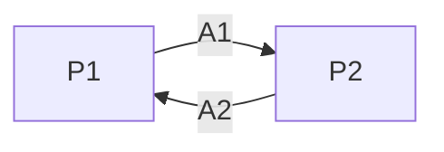

# Screens

This step sits between the spec and the prototypes: it turns user stories, written with any
method (`/to-spec`, BMAD stories, a hand-written file), into entries of `docs/ui/screens.md`.
It decides which screens exist and what each one does; it does not prototype or build them.

## 1. Read the inputs

- The spec given as argument: a file (read it in full), a GitHub issue
  (`gh issue view <number> --comments`) or a story file. Without an argument, ask which spec;
  never guess
- `GLOSSARY.md` and `docs/adr/`, when they exist: use their terms
- `docs/ui/screens.md`, `docs/ui/flows/` and the router: the screens and routes that already exist
- `docs/ui/design-system.md`: while its status is `not defined`, the screens can be listed, but
  tell the developer that none is prototyped or built before the design system

## 2. Complete the acceptance criteria

Every story with a user interface needs Given/When/Then criteria covering:

- the main path
- the empty state, when the screen shows a list or optional data
- the error states that can happen (invalid input, not found, not allowed)

Stories without a user interface (background jobs, integrations) are marked as "no screen"
and skip this step.

When criteria are missing, propose them in Brazilian Portuguese, keeping the Given/When/Then
structure (Dado/Quando/Então), e.g.:

```
- Dado que não tenho pedidos, quando abro a página de pedidos,
  então vejo "Você ainda não tem pedidos" e um botão "Novo pedido"
```

Never invent business rules: what the spec does not say becomes a question. After the
developer confirms, record the criteria where the spec lives: edit the file, or ask before
adding a comment to the issue (`gh issue comment`).

## 3. Find the screens

A place is where the user has a set of actions and cannot interact with what is behind it:
a page, a modal, a step of a multi-step form. Dropdowns, flash messages and tooltips are not
places.

- One screen per LiveView route; a `live_action` with its own path (`/orders/new`) is a
  route. A modal without its own path belongs to the screen it opens on
- LiveView names follow the Phoenix generators: `__APP_MODULE__Web.<Resource>Live.Index`,
  `.Show` and `.Form`
- When a story changes a screen that already exists, update its entry instead of creating
  another one. If its status is past `specified`, tell the developer that the change reopens it
  and set it back to `specified`

## 4. Map the flow (two or more screens)

When the spec creates or changes two or more screens, write `docs/ui/flows/<spec-slug>.md`
in Brazilian Portuguese (code names, routes and functions stay in English); for a single
screen, skip this step. Context functions are proposals named with the glossary
terms; the tickets settle them.

````markdown
# <Título da spec>

Spec: <link>

## Lugares

| ID | Lugar | Rota e entrada |
|---|---|---|
| P1 | Lista de pedidos | `/orders` |
| P2 | Novo pedido | `/orders/new`, a partir de A1 |

## Ações

| ID | Lugar | Ação | Tratada por | Leva a |
|---|---|---|---|---|
| A1 | P1 | botão "Novo pedido" | `navigate` | P2 |
| A2 | P2 | envia o formulário | `handle_event("save")` → `Orders.create_order/2` | P1 com "Pedido criado", ou P2 com os erros |

## Fluxo


````

## 5. Propose and confirm

Present in one round, and wait for the developer's answer before writing:

- the screens, each with its route, LiveView and stories
- the coverage: a table from every story to its screens; every story with a user interface is
  covered, and the "no screen" stories are listed
- for each screen, a recommended `Prototype` value with a one-line reason: `required` when its
  look needs to be decided first (a new layout, a dashboard, a key screen), `none` when the
  existing components are enough (forms, lists, details). The developer decides

## 6. Write the entries

Add or update the entries in `docs/ui/screens.md`, in its format and in Brazilian Portuguese
(the field names and status values stay in English): `Specs` links the stories,
`States` comes from the criteria (empty, error, success), `Flow` links the flow file when there
is one, and `Status` is `specified`. Then stop: do not prototype, create tickets or write code.
Tell the developer the next step: prototyping the `required` screens with
`/prototype-screen <screen>` or creating the tickets.
